## Approved navigation and legibility release — October 28, 2026

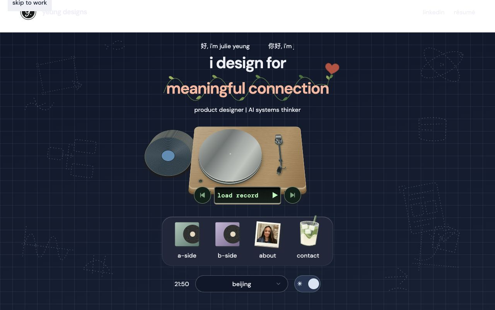

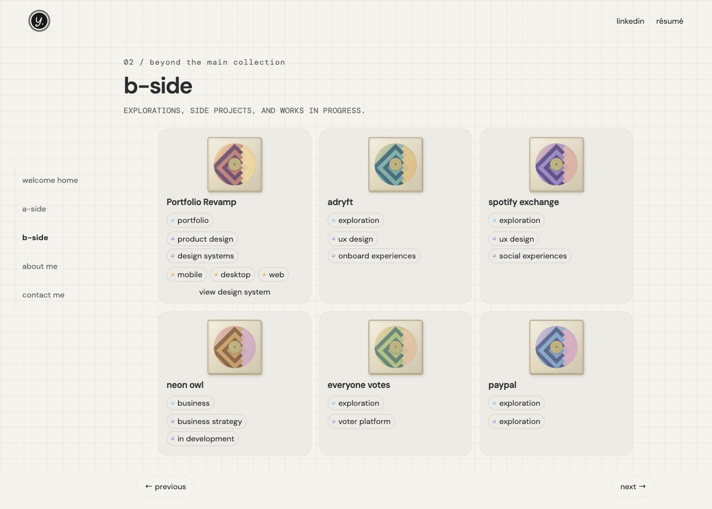

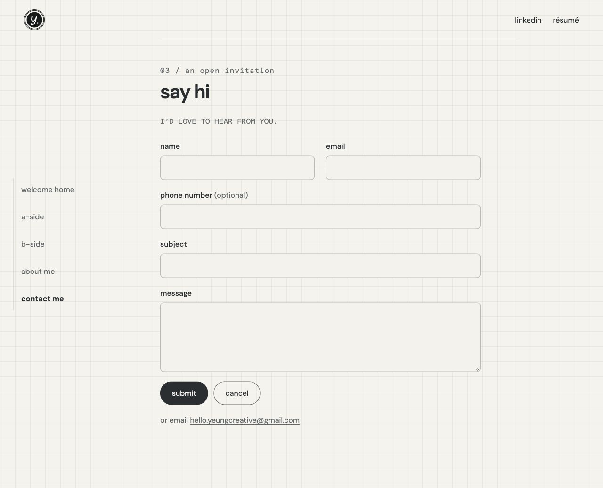

## Approved cross-page consistency checkpoint — October 28, 2026

GitHub checkpoint; public publication remains separate. The screenshots below preserve the reviewed stage before the next chip-fit and stack-animation experiment.

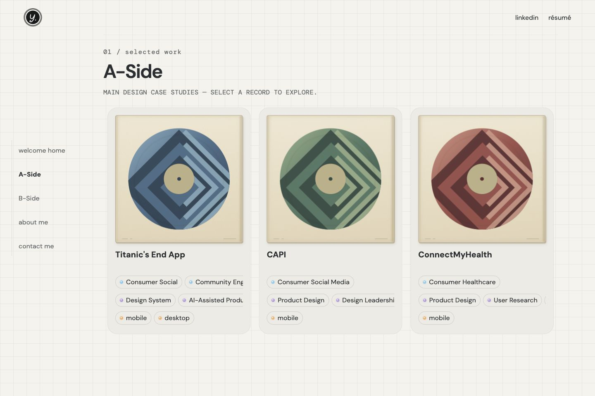

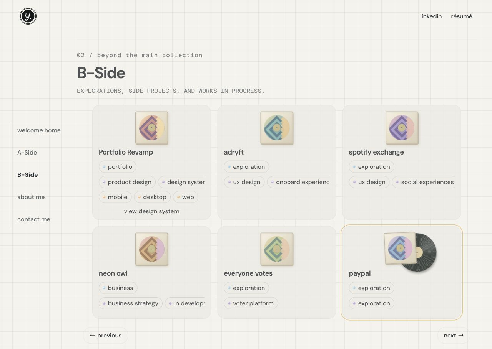

## Approved emotional-design release — October 28, 2026

Julie's supplied approval references preserve the mobile bottom island, matcha contact artwork, larger attached heart and paired settings. Theme colors respond to the selected time/location; these screenshots are not a new fixed palette. See [the release contract](../design-system.md).

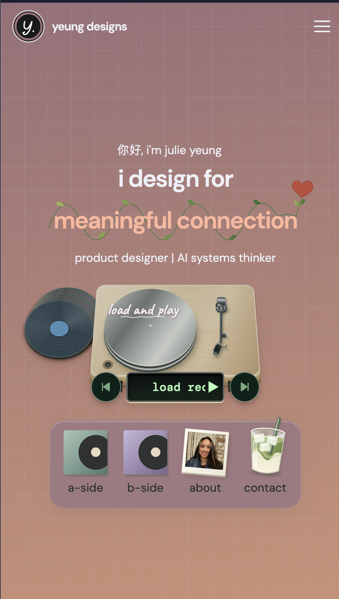

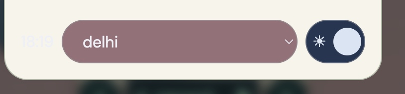

## Living visual reference — October 28, 2026

The consolidated guide at `/design-system/` combines words and live component visuals, accessible through B-Side. Selecting a component focuses its actual visual; Full page restores context. Six viewport presets expose real responsive measurements rather than screenshot estimates. Short summaries and expandable specifications preserve detail without putting every rule on screen at once.

## Approved player-first release — October 28, 2026

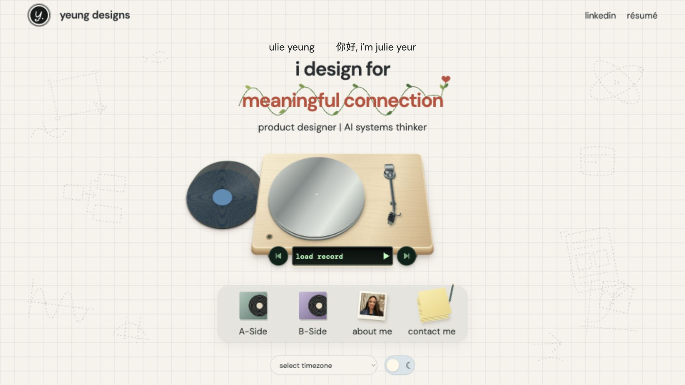

Current visual authority: table-free player, three equally spaced groups, larger wide-screen composition, single menu island, full timezone label and matching settings controls. See [the current sizing contract](../design-system.md). Earlier captures below are historical where they differ. Mobile bottom-menu restoration and the consolidated design-system website are queued separately and not included in this approval.

## Preserved records-upfront checkpoint — October 28, 2026

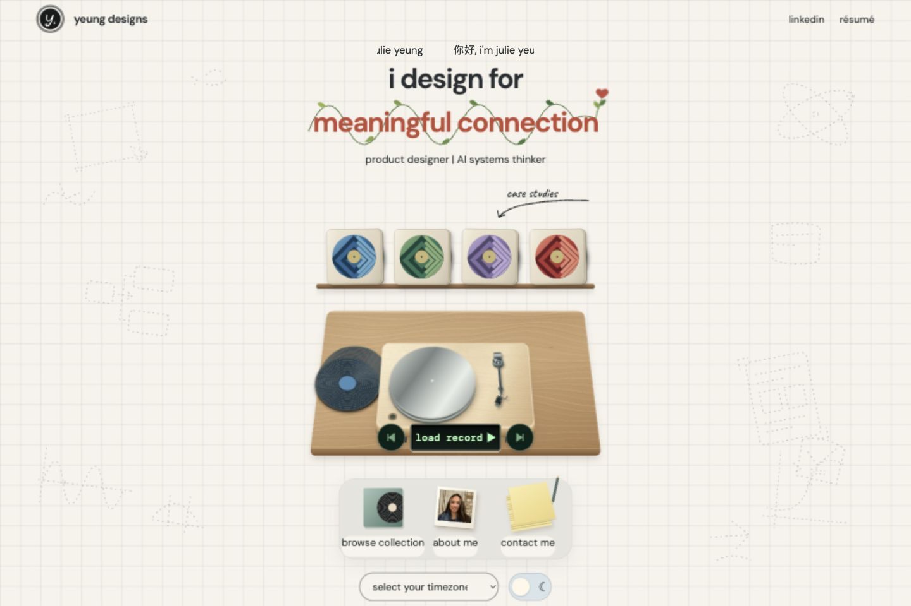

Preserved at Julie's request before exploring collection-only discovery. This captures the active local composition and soft vector logo. GitHub checkpoint only; no public deployment requested. Earlier visual explorations remain historical unless specifically retained in the current contract.

## Approved current LED — October 28, 2026

Preserve the LED, floating skip controls and their spacing according to [the sizing contract](../design-system.md). Approval covers this component only; other elements visible in these screenshots remain pending previews. Earlier LED sizing references below are historical.

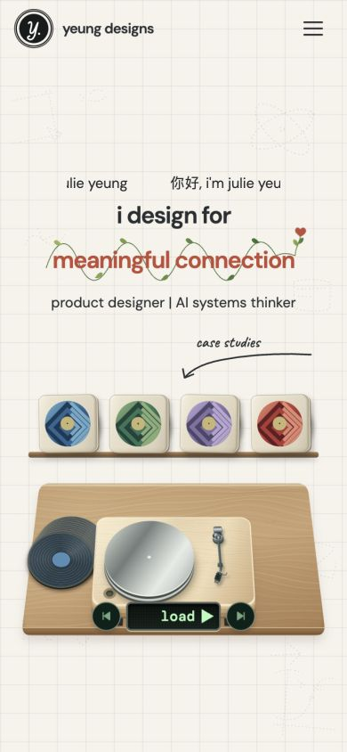

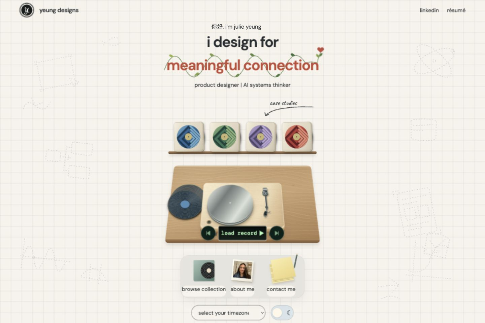

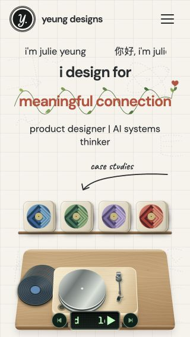

## Approved responsive typography — October 28, 2026

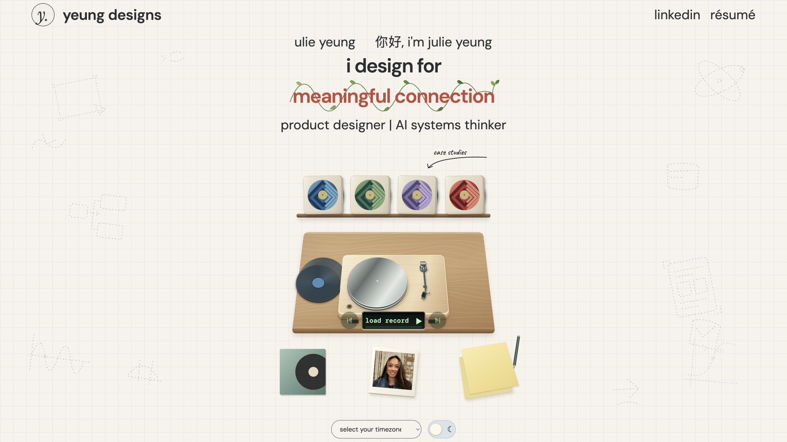

Julie approved the text scaling at 3:27 AM. Header mark/name, links, greeting and role use the responsive sizes in [the design contract](../design-system.md). This reference approves typography only: the local LED controls, table perspective and gallery experiments are outside this release.

## Approved landing rhythm and front-edge LED — October 28, 2026

**Approved:** Julie reviewed the local preview and authorized publication at 2:55 AM. Preserve equal inter-group gaps of 6% of scene width and the half-size LED attached over the player’s front edge. See [the current sizing contract](../design-system.md).

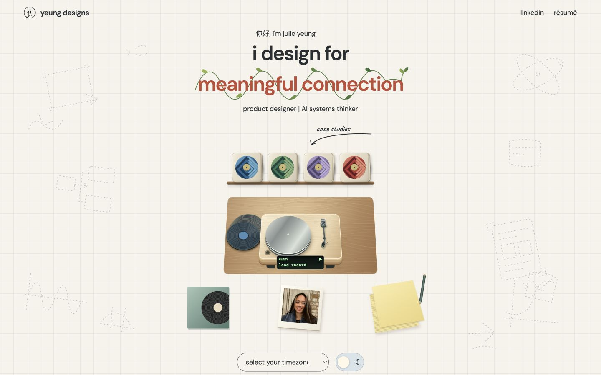

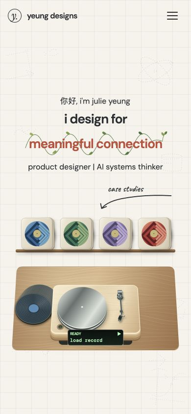

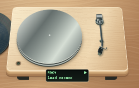

The full-page captures are implementation evidence from the reviewed preview; the close-up is Julie’s supplied approval screenshot. Approval covers spacing and LED placement, not unrelated pending gallery/playback experiments. Short landscape retains scrolling rather than reducing minimum control sizes. Earlier full-size separate LED-row references below are historical for placement; their material treatment remains relevant.

## Approved update: rounded wooden table — October 28, 2026

**Status:** reviewed in the local preview; Julie explicitly approved publication and documentation updates. This supersedes sharp tabletop corners in earlier captures.

The table and player share a 12px corner-radius value. The table keeps its tapered top edge, oak grain and existing proportions; a responsive curved outline replaces the sharp polygon cutout. Preserve this rounded treatment at every scene size. The retained image is a small implementation crop; it documents the approved treatment but does not establish full-screen or all-state verification. See [the design description](../design-system.md) for ownership and sizing.

**Review workflow:** show the local preview before changing the accepted description or visual reference. Only after explicit approval should the documentation be updated and the change pushed/published. Unapproved preview captures must not be labeled approved.

# Visual component reference library

Updated October 28, 2026. This library stores visual evidence alongside component rules so future work does not reconstruct the design from prose alone. References are local, durable copies, outside the published `dist` folder.

## How to use this library

Before changing a component, inspect its visual reference and its preservation rules. A screenshot is evidence only for the named detail: it does **not** approve the whole screen. Latest explicit user decisions override older images. Never silently replace a reference with the latest implementation.

Status labels: **Preserve** = explicitly requested detail; **Context** = historical appearance, not approved as a whole; **Regression** = known problem to avoid; **Pending** = no approved visual yet. Implementation screenshots must be labeled with their viewport, theme, state and date, and remain separate from approved references.

For each future component update, add a before/after screenshot at matching viewport and theme. For motion, add a short recording or start/mid/end frames plus trigger, duration, result and reduced-motion behavior. Check touch and keyboard as well as pointer input. Do not mark untested states verified.

## LED screen / physical component

**Preserve: physical housing. Context: surrounding scene.** The user explicitly likes the physical LED screen. Retain recessed dark glass, a thin muted rim, rounded corners and green display contrast. Do not use this image to approve table placement, tiny typography or READY wording. Latest empty-state wording is **load record**; loaded state shows song name. Solid lettering and matching play/pause icons supersede pixelated lettering.

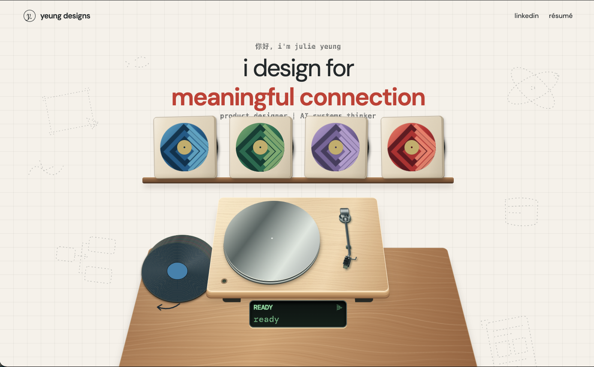

Source: user-supplied desktop screenshot, October 28, 12:45:05 AM. Pixel dimensions are screenshot dimensions, not a verified CSS viewport. A tighter approved component capture is still needed; do not infer exact dimensions from this full-screen image.

## Shelf sleeves / shared artwork

**Preserve: shared identity across compact and expanded states. Context: this compact appearance.** Refer to the four sleeves in the desktop image above: cream square jacket, circular artwork, blue / green / purple / red palette. Expanded artwork must retain the same colors and relative circle-to-square proportion. Do not recreate a different illustration when expanding.

**Pending:** approved compact/expanded side-by-side captures. Desktop interaction: at least two seconds of sustained hover before expansion; first tap opens the gallery immediately. Expanded browsing exposes neighboring records. Screenshots cannot establish motion correctness.

## Header logo / favicon

**Context: current favicon asset. Preserve: matching identity.** The favicon must match the circular “y.” header mark. This saved asset records the current implementation, not new user approval of every rendered detail. Compare against a header capture before changing either.

## Mobile layout / regression reference

**Regression — do not reproduce this layout.** This screenshot records undersized shelf controls, crowded player/LED composition and the browse label overlapping the timezone selector. Retain desktop object identity and proportions while allocating enough space for labels and controls. Do not shrink the entire interface until tap targets or text become unusable.

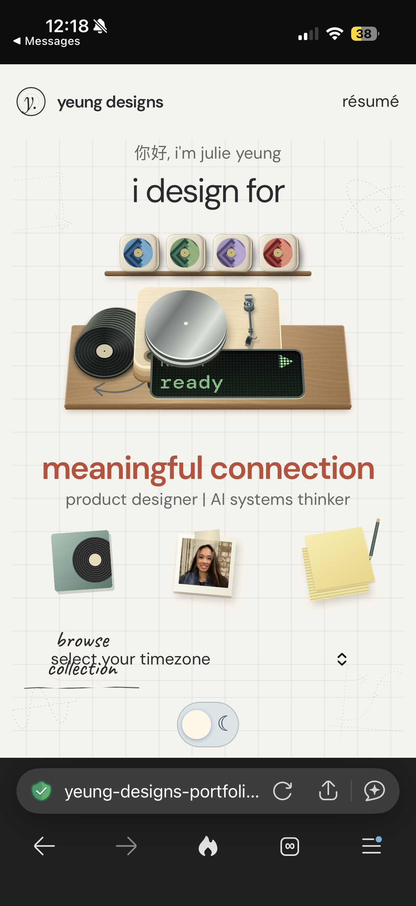

Source: IMG_6254.PNG. Actual CSS viewport and browser scaling were not captured. This is a failure reference, not a mobile target design.

## Component evidence still needed

| Element / pattern | Required visual evidence | Preserve / verify |
| --- | --- | --- |
| Expanded sleeve | Compact and expanded pair, both themes; long-chip example | Same artwork proportions; chips contained; no heading box or text overlap; readable solid impact statement |
| Accent links | Header link and View Record side by side | Accent color and thin squiggly underline; no half-button border |
| Player / side stacks | Empty, playing, paused, switching frames; short motion recording | First-tap action, clear song title, coherent depth movement; arrows hidden when not hovering/focused per latest explicit request |
| Header / typography | Full header at desktop and phone widths | Solid matching headline typography, solid role text, centered slow greeting marquee |
| Theme / timezone | Both themes, open menu and keyboard focus | Rounded menu; opposite-action toggle label; contrast and no overlap |
| Vine animation | Start, middle, final frames or recording | Left-to-right growth around words, final sprout at final n; reduced-motion equivalent |
| Responsive composition | Matching desktop/phone screenshots with viewport sizes | Table placement, full-frame intent, readable controls and no clipping; document unresolved fit conflicts |

Earlier temporary component screenshots are no longer on disk. Do not invent replacements or label current implementation as approved to fill these gaps. The touch interaction recommendations from the side conversation remain proposals unless explicitly adopted; they do not silently replace the existing interaction contract.

## Home scene contract — October 28, 2026, 01:37 references

### User-supplied component references

- **Player:** Screenshot 2026-10-28 at 1.37.26 AM.png. Preserve the light wood deck, softly rounded edges, metallic platter, tonearm, feet and separate recessed green LED shown in the conversation. The LED reads “load record” when empty. Reference establishes component appearance, not verified measurements.
- **Table:** Screenshot 2026-10-28 at 1.37.58 AM.png. Preserve the warm wood tabletop, softened corners, perspective and solid front edge. The player in this reference sits toward the back; this placement is not the desired centered placement.
- **Storage gap:** both supplied temporary paths were unavailable when saving this entry; neither original was found on Desktop or Downloads. Images remain visible in the conversation but have NOT been copied into this library. Obtain durable copies before claiming this entry has stored visual evidence. Do not substitute generated or reconstructed images.

### Requested design intent

Home should feel soft and approachable, with rounded component edges. Preserve each graphic’s proportions across screen sizes. Center the record player horizontally and vertically on the tabletop. Fit the landing composition within the available window, without text overlapping.

### Recommended implementation specification (proposal)

- Keep table, deck, platter, tonearm and discs in one shared scene coordinate system, scaled uniformly with a single aspect ratio. Preserve the intended perspective: do not stretch width and height independently. Interactive targets and text must retain usable minimum sizes.
- Define player placement using the center of the deck footprint and the center of the usable tabletop surface, excluding the front edge, shadows, side discs and LED. This is a proposed precise interpretation of “center”; the screenshot is not evidence of that alignment. Verify apparent centering after perspective is applied.
- Reserve a separate area for the LED beneath the deck, contained on the table and clear of discs. Do not include its separate display in the deck-centering measurement by accident.
- Use normal-flow layout for header, headline/role, shelf, scene, navigation and footer controls. Reserve space for labels and decorative overhang; no text clipping, overlap or arbitrary offsets used to hide layout conflicts.
- Available height means the visible browser viewport minus page header, safe-area padding and other reserved rows. Size the scene from BOTH available width and height. Do not hide overflow as proof that content fits.
- One-window fit is the requested goal. At extreme aspect ratios or enlarged text, this can conflict with minimum type and target sizes. Report the conflict; do not silently shrink, clip, omit content or change proportions. Scrolling or alternative arrangements remain recommendations, not an approved exception.

### Required responsive review procedure

Check narrow phones, typical phones, tablets, desktop and short landscape screens. Resize continuously between sizes and check enlarged text. Capture matching comparisons in both themes and empty, playing and expanded-record states. Include paused/switching states for player changes. Record actual CSS viewport dimensions and what was tested.

Compare against the named visual reference for the affected component. Verify proportions, apparent table/deck centering, readable labels, target sizes, no unintended horizontal overflow and no text overlap. Expanded content must remain reachable; report any conflict with one-window fit. Motion needs a recording or start/middle/end frames. If constraints conflict, explain the tradeoff rather than silently changing proportions. Do not mark a screenshot or state approved merely because it was captured.
